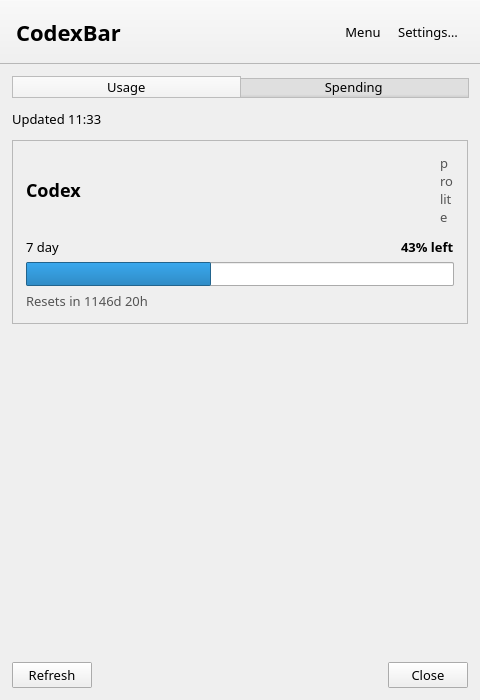
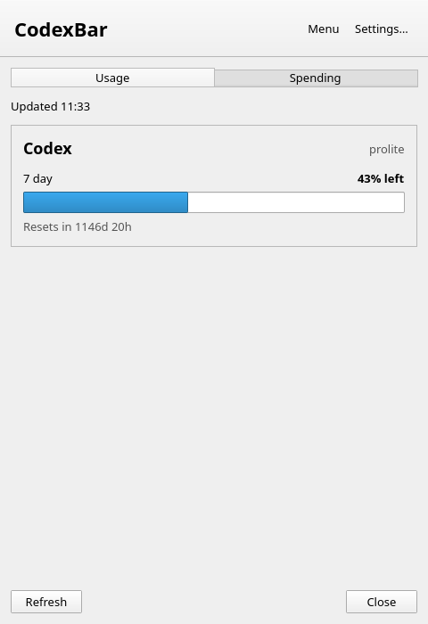
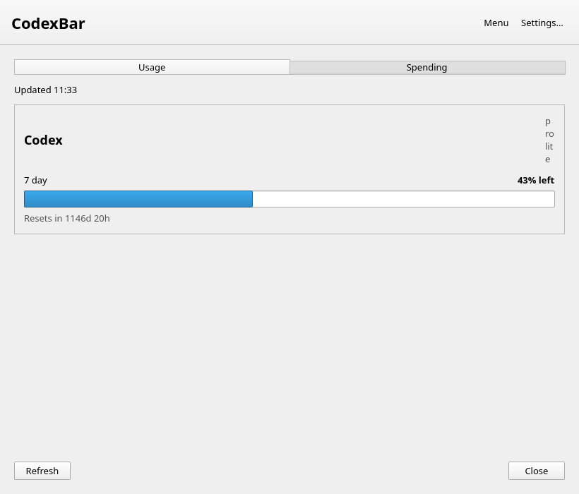
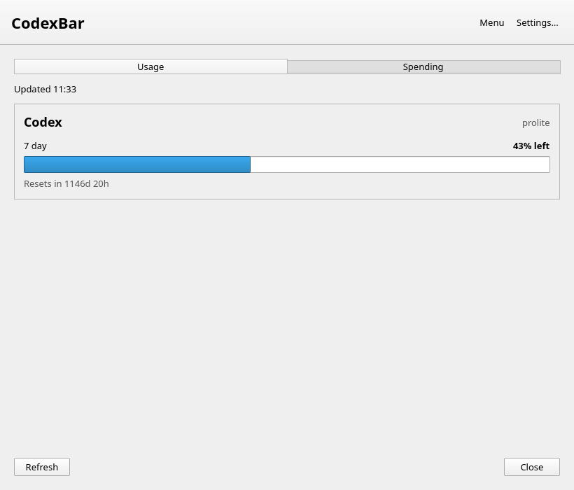
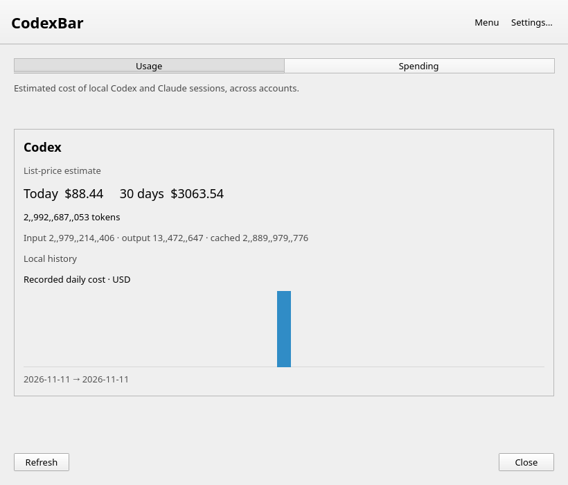
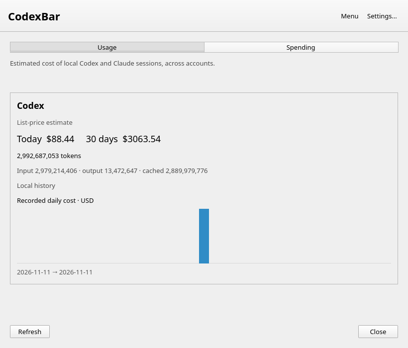

# Linux dashboard behavior proof

Captured from the actual, unmodified desktop entry point and bundled Usage/Spending views on Qt 6.4.2 (Ubuntu 24.04, X11/xcb, Xvfb, software rendering). These are desktop program screenshots, not standalone QML component renders. Both programs were independently built from source with qmake6 and make.

- Before: upstream 7447bc77c2497323d9c41e40164ce705533493c8.
- After: PR code 5306933551dded7f8cd3183a9e20720dfb1ea77b.
- Same isolated HOME/XDG configuration and deterministic fake CLI data, with no real account credentials or identities. The plan string `prolite` and token values are fixtures. Spending amounts are fixture values, not a validation of pricing calculations.
- Usage screenshots cover 480×700 and 820×700 client areas. Spending screenshots cover 820×700.
- Xvfb has no window manager; this evidence verifies the real dashboard rendering and CLI-to-view path, not compositor placement or decoration behavior.

## Usage, narrow

Before:



After:



## Usage, wide

Before:



After:



## Spending

Before:



After:



## Regression comparison

The same QML tests were run against both source trees. Baseline: 16 passed, 5 failed (duplicate separators). PR: 21 passed, 0 failed. The standalone plan component test passes on both trees; the full application screenshots above reproduce the header layout bug and demonstrate its fix. Raw output is in base-regression.log and head-regression.log.

## Reproduce

Install Qt 6.4 development/runtime modules, Xvfb, xwininfo, ImageMagick and Python 3. Build each revision independently using qmake6 and make, then run:

```sh
python3 capture.py --base /absolute/path/to/base/codexbar-linux --head /absolute/path/to/head/codexbar-linux --output /absolute/path/to/screenshots
```

The script starts an isolated Xvfb display :193, launches each built program with a fake CLI, resizes its Usage window through X11, opens Spending via the app IPC command, and captures the resulting windows. Display :193 must be free.

## Maintainer decision

This evidence demonstrates the short plan-label fix. The PR also deliberately changes long labels from wrapping to right elision. Maintainer approval for that presentation change is still requested; screenshots do not constitute that approval.
