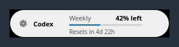
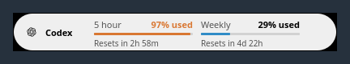
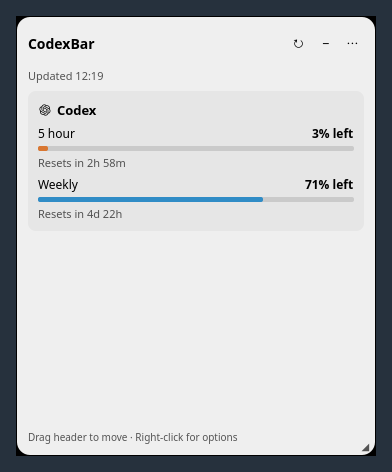
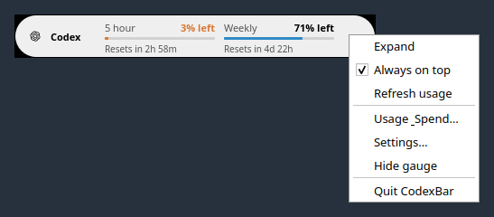
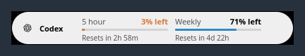
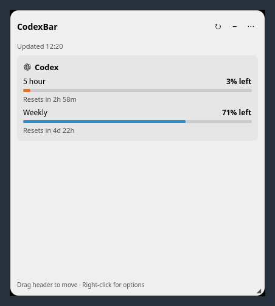

# Linux floating gauge runtime proof

These screenshots capture the built desktop executable and its bundled QML on
Qt 6.4.2 / Ubuntu 24.04. They are not standalone component renders. A private Xvfb
display runs Xfwm4, the xcb platform plugin, and Qt software rendering. XTest sends
the actual mouse clicks, drag, and resize gestures.

All usage comes from a fake CLI under private HOME/XDG directories. No real
accounts, email addresses, credentials, or live provider endpoints are involved.
The fixtures demonstrate a reported weekly window and reported 5-hour + weekly
windows; they do not assert which subscription tiers include particular windows.

Code captured: `6992c2cbcc2a0aa3d2bda67eb5573081c713ab38`.
The exact binary SHA-256 and observed geometry are in [results.json](results.json).
The desktop entry point and bundled QML were built from this code without
modifying the production paths for capture.

## Compact windows follow reported quotas

Weekly only: 42% remaining, countdown visible, no 5-hour placeholder.



Two windows: 3% remaining in the 5-hour window, highlighted as low, and 71% weekly.


Changing the display preference to used shows 97% and 29%, respectively.



## Real clicks open the panel and native menu

Clicking the capsule restores its saved expanded size (360 × 440 in this fixture).
The panel shows both windows and their reset countdowns.



Right-clicking the 48px capsule opens a 145 × 186 native menu outside its bounds.



## Move, resize, and restart

With Xfwm4, the script drags the expanded header from (24, 24) to (84, 54), resizes
the panel from 360 × 440 to 420 × 470, and clicks its collapse button. After
quitting while expanded and starting with `--background`, the gauge returns as a
400 × 48 capsule at the saved (84, 54) position. Another click restores 420 × 470.
The weekly-only scenario also restarts collapsed, at 268 × 48.





## Query checks

For each scenario, all opening, expanding, collapsing, preference, menu, and
geometry interactions leave the fixture CLI call log unchanged. Including one
restart, there are exactly two usage queries (one per process startup) and zero
cost queries. `config providers` is also called once per startup to populate the
provider catalog. The assertions and call lists are recorded in `results.json`.

## Reproduce

Use the feature branch and build into a fresh directory:

```sh
mkdir -p /tmp/codexbar-floating-proof-build
cd /tmp/codexbar-floating-proof-build
qmake6 /absolute/path/to/checkout/Integrations/Linux/codexbar-linux.pro
make -j4
cd /absolute/path/to/checkout
python3 .github/pr-proof/linux-floating/capture.py \
  --binary /tmp/codexbar-floating-proof-build/codexbar-linux \
  --output /tmp/codexbar-floating-proof \
  --display :194
```

Requirements: Qt development and QML runtime modules, Python 3, Xvfb, Xfwm4,
dbus-run-session, xwininfo, xprop, xsetroot, ImageMagick `import`, libX11, and
libXtst. Display :194 must be free. Production sources under `Integrations/Linux`
must match HEAD; the capture script checks this before running.

## Limits

This demonstrates one X11 window manager. `_NET_WM_STATE_ABOVE` is observed on the
gauge, but overlapping-window stacking and keyboard focus transfer are not
asserted by this script. Wayland and other compositors need separate validation.
Compositing is disabled in the private Xfwm4 session, so transparent corners
appear black; captures are not retouched to hide that environment limitation.
Reset countdowns and updated timestamps are time-dependent fixture displays.
