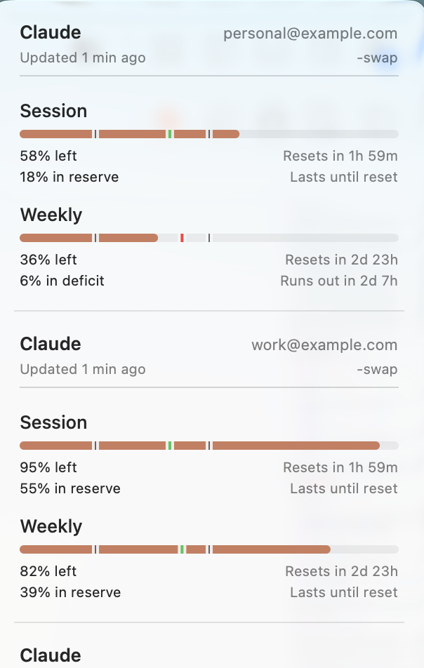
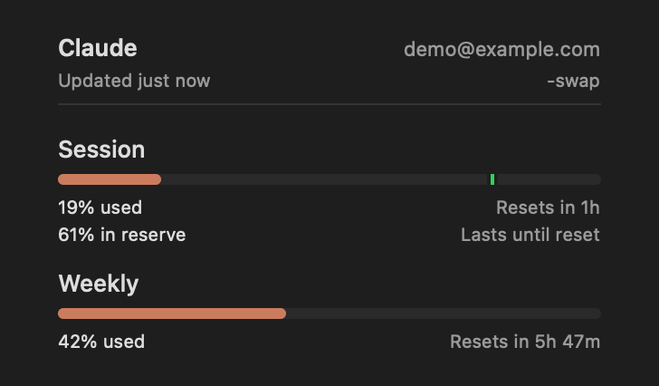
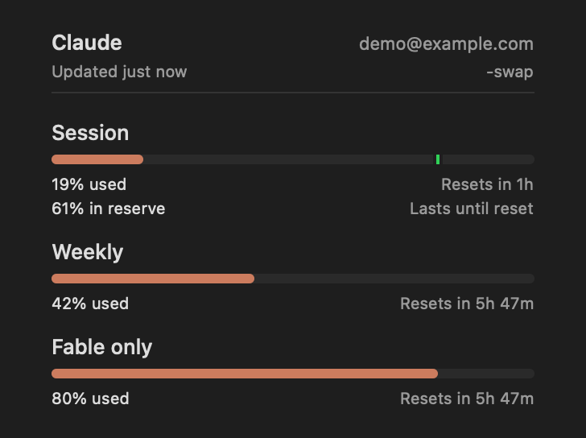

# Claude provider

Enable **Settings → Menu Bar → Show all accounts in Overview** to include this provider’s cached account
cards in Overview. The existing account source and provider selection remain unchanged; see
[Overview account rows](configuration.md#menu-bar-controls).

The **Plan Usage** submenu includes recorded remaining-quota burndown above utilization history,
using the same Session, Weekly, and Sonnet labels. See [recorded quota burndown](widgets/burndown-proof.md)
for capture-age semantics and the existing history retention/privacy behavior.

OAuth history uses a stable account/profile identity after two stable credential observations corroborate that
binding. External token rotations therefore continue the same history after the new credential is corroborated.
Saved token-scoped fragments with matching verified bindings migrate into that account's history on a successful
sample. Unbound fragments, obsolete bindings, and other accounts stay separate; correcting a conflicting binding
preserves its ambiguous old fragment without attributing it to the newly confirmed account. If that fragment was
already merged, the affected account bucket is preserved but hidden, and fresh samples start a new account scope.
This quarantine survives empty responses and restarts. Explicit OAuth tokens without Claude Code account evidence
remain credential-scoped.

Claude supports three usage data paths plus local cost usage. The main provider pipeline uses runtime-specific
automatic selection, but the codebase still has multiple active Claude `.auto` decision sites while the refactor is
pending. For the exact current-state parity contract, see
[docs/refactor/claude-current-baseline.md](refactor/claude-current-baseline.md).

When an Anthropic Admin API key is configured, Claude can also show organization-level spend/messages/tokens in the
same inline dashboard pattern used by the OpenAI API provider.

Incomplete proxy records with an explicit null `stop_reason`, positive input, zero output, and no cache counters are excluded from token and cost totals until a completed record arrives. Their day and model stay visible with an **Incomplete** marker and an excluded-request count. Known usage remains a partial subtotal; an incomplete-only period stays unavailable rather than becoming zero. Older caches are rebuilt once to apply this distinction. Missing `stop_reason` alone retains compatibility with older complete logs.

Completed requests for models without a known price keep their token usage and report unpriced coverage. Usage & Spend retains the priced subtotal from the other requests and days as a lower bound; unknown prices do not become zero. Fully priced history keeps its usual estimated totals.

## Data sources + selection order

### Default selection (debug menu disabled)
- If an Admin API key is configured, the Admin API strategy is used for Claude API spend/usage.
- App runtime main pipeline: OAuth API → CLI PTY → Web API.
- CLI runtime main pipeline: Web API → CLI PTY (Linux: Web API → OAuth API → CLI PTY).
  Since 0.78.0, Auto `usage` first uses the active slot when the claude-swap integration is enabled;
  explicit source/account selection bypasses it. See [CLI precedence](cli.md#command).
- Explicit picker modes (OAuth/Web/CLI) bypass automatic fallback.
- Explicit OAuth retains the last successful quota measurement through recognized temporary network failures,
  including localized DNS/offline errors. Its original timestamp remains visible; authentication rejection still
  follows the existing invalidation and credential-owner rules.
- A lower-level direct Claude fetcher still contains a separate `.auto` order. That inconsistency is tracked in
  [docs/refactor/claude-current-baseline.md](refactor/claude-current-baseline.md).

Usage source picker:
- Preferences → Providers → Claude → Usage source (Auto/OAuth/Web/CLI).

When an account-widget identity check or successful web enrichment returns an OAuth profile, its same-token email is
retained for display even if the profile lacks the organization needed to verify widget ownership. A failed
optional profile check leaves successful usage available. Ordinary OAuth refreshes also start one background
profile lookup per credential, bounded to two seconds, without waiting for it to publish quota usage. The first
refresh may omit the email while that request is in flight; later refreshes reuse its result, including a failed
lookup, until the token changes or CodexBar restarts. This process-local display cache cannot establish widget
ownership. Organization UUIDs are ownership evidence, not organization display names.

Admin API key setup:
- Preferences → Providers → Claude → Admin API key, stored in `~/.codexbar/config.json`.
- CLI/env: `printf '%s' "$ANTHROPIC_ADMIN_KEY" | codexbar config set-api-key --provider claude --stdin`.
- Token accounts can also hold `sk-ant-admin...` keys; they route to the Admin API instead of cookie/OAuth usage.
- Environment fallback: `ANTHROPIC_ADMIN_KEY`.

## Usage Dashboard

The default and API-account Usage Dashboard action opens [Platform usage](https://platform.claude.com/usage). Accounts recognized as Claude subscriptions open [Settings → Usage](https://claude.ai/settings/usage). This action does not change the configured usage source.

## Admin API
- Key prefix: `sk-ant-admin...`.
- Endpoints:
  - `/v1/organizations/cost_report`
  - `/v1/organizations/usage_report/messages`
- Output:
  - Today/7d/30d spend and message/token summaries.
  - Inline 30-day dashboard chart when daily buckets are present.
  - Identity login method: `Admin API`.

### Optional workspace spend

Enable **Show workspace spend** in Settings → Providers → Claude, set `claudeWorkspaceSpendEnabled: true` on the
Claude provider config entry, or set `ANTHROPIC_ADMIN_WORKSPACE_SPEND=true`. It is off by default and applies only
to the Admin API source.

The existing [cost report](https://platform.claude.com/docs/en/api/admin/cost_report/retrieve) request adds
`group_by[]=workspace_id` alongside `group_by[]=description`; no extra request or credentials are required.
The organization totals, cost items, token summaries, and daily chart remain unchanged. When more than one workspace
has cost rows, **Workspace spend · 30d** shows up to 20 workspaces, highest spend first, over the same 30-day buckets
as the organization total. Labels use workspace IDs; a null workspace is **Default**. Amounts are converted from
Anthropic's USD cents to dollars. A single workspace keeps the existing organization view.

## Recover usage when Claude is already signed in

A working Claude Code login or Claude browser tab does not by itself confirm that CodexBar can read that
session. For example, OAuth can report missing credentials, the CLI probe can time out, and Web can report
`No Claude session key found in browser cookies.` on the same machine. Diagnose the selected source before
signing out or replacing credentials.

If Claude works in Chrome but CodexBar cannot import its browser session:

1. Open `https://claude.ai` in Chrome and confirm the intended account is signed in.
2. In Settings → Providers → Claude, select **Web API (cookies)** and leave the cookie source on **Auto**.
   This uses the browser session for session, weekly, and available model-specific quotas.
3. In Settings → Advanced, confirm **Disable Keychain access** is off. Chromium cookie decryption needs
   the browser's Safe Storage Keychain item; Claude's OAuth prompt policy controls a different credential.
4. Explicitly retry the import from Terminal:

   ```bash
   codexbar cookie refresh --provider claude --allow-keychain-prompt
   ```

   Approve the expected macOS Keychain prompt for the installed CodexBarCLI and the browser's Safe Storage
   item. The command never prints cookie values. A prior denial can suppress imports for six hours;
   this explicit retry can bypass that cooldown, while ordinary refresh attempts may remain suppressed.
   See [Keychain prompts](keychain-prompts.md) for permission details.
5. Click **Refresh** in Claude's settings and confirm that **Updated just now** appears with current quota
   bars and no fetch error. Local cost totals or last-known quota bars alone do not prove a successful refresh.

This recovers browser-session access; it does not repair missing OAuth credentials. If the refreshed session
instead reports a Cloudflare challenge, follow the network guidance under Web API below rather than repeating
the cookie import.

## Passive CLI sessions and macOS sleep

After each passive request in the reusable CLI session, and when that session closes, CodexBar sends SIGTERM
only to `/usr/bin/caffeinate` processes in the session's own process group. The session remains available for
later requests. There is no recurring process scan; other process groups and other executables are left alone.
This cleanup applies to the reusable PTY session, not the separate one-shot usage or auth-status commands.

## Keychain prompt policy (Claude OAuth)

If CodexBar reports that its Claude OAuth cache is temporarily unavailable in macOS Keychain, check
that the login keychain is unlocked in Keychain Access, then retry Refresh. This guidance does not
change the existing prompt policy or switch to another credential source.

- Preferences → Providers → Claude → Keychain prompt policy.
- Options:
  - `Never prompt`: never attempts interactive Claude OAuth Keychain prompts.
  - `Only on user action` (default): interactive prompts are reserved for user-initiated repair flows.
  - `Always allow prompts`: allows interactive prompts in both user and background flows.
- Explicit Refresh can repair Claude OAuth Keychain access when direct-read consent is enabled and the policy
  allows user prompts. Ordinary OAuth fetches remain noninteractive, including with `Always allow prompts`;
  that policy still governs the existing delegated refresh and experimental reader paths.
- After a missing-credentials failure, a newer Claude Code credential timestamp replaces the stale error with
  **Claude Code credentials changed** and a **Refresh** instruction in the menu and OAuth CLI output. Click the
  existing menu **Refresh** action to retry; direct-read consent and the prompt policy still control access.
  The freshness probe reads only Keychain attributes with UI disabled and the credentials file's modification
  time. It never requests the Keychain credential payload, launches Claude, or grants access in the background.
  A changed timestamp can mean a login or token rotation; it does not prove the credential is valid. Custom
  credential profiles use their own file timestamp, never the global Claude Code Keychain item. CodexBar saves
  only the last failure time per profile so the guidance survives restarts and is shared with the bundled CLI;
  a readable credential clears it. Auto continues to configured CLI/Web sources under their existing access gates.
- This setting only affects Claude OAuth Keychain prompting behavior; it does not switch your Claude usage source.
- The policy also applies to the experimental `/usr/bin/security` reader and delegated OAuth refresh through
  `claude`: background operations that can prompt require `Always allow prompts`.
- CodexBar's `Always allow prompts` permits future prompts; macOS's **Always Allow** grants access to the current
  Keychain item. Claude Code can recreate `Claude Code-credentials` and reset that grant. An ACL entry still named
  CodexBar does not prove that its stored code-signing requirement matches the running binary. `Only on user action`
  reduces background interruptions but may require a manual Refresh to recover OAuth access. In #3798, a
  before/after trace shows Claude Code preserving the decrypt ACL's CodexBar entry but removing CodexBar's Team ID
  from the separate partition ACL. Decrypt-ACL preflight alone cannot establish partition authorization; repeated
  manual grants therefore need not survive the next Claude Code refresh.
- If Preferences → Advanced → Disable Keychain access is enabled, this policy remains visible but inactive until
  Keychain access is re-enabled.

### Debug selection (debug menu enabled)
- The Debug pane can force OAuth / Web / CLI.
- Web extras are internal-only (not exposed in the Providers pane).
- CLI Web enrichment requires matching nonempty account emails; an organization display name alone cannot authorize
  merging another session's optional usage or spend. OAuth enrichment retains verified organization-UUID matching.

## OAuth API (preferred)
- OAuth refresh form-encodes credential values, preserving literal plus signs and other reserved characters.
- Expiry values outside the diagnostic integer range are reported as `out_of_range` without changing credential expiry or refresh decisions.
- Credentials:
  - Explicit OAuth environment override, when configured.
  - CodexBar OAuth cache when available.
  - File fallback: `~/.claude/.credentials.json`.
  - Claude CLI Keychain bootstrap/repair fallback: `Claude Code-credentials`.
- When a CodexBar-owned OAuth cache item's ACL rejects the current build, fresh credentials from an allowed source
  can replace that cache item using no-UI deletion and creation. A locked or inconclusive Keychain is preserved;
  failed ACL repairs back off for five minutes. This never deletes or recreates Claude Code's credential item.
- If CodexBar's cache is temporarily unavailable, automatic refreshes can reuse an unexpired credential already in
  memory beyond the normal 30-minute cache window, ahead of a stale credentials file. Each refresh retries the
  persistent cache. Token expiry, profile changes, cache invalidation, and Never prompt still prevent reuse;
  after a rejected cache write, the next refresh first clears the stale persistent entry, then reuses and persists
  an unexpired in-memory credential even after 30 minutes once that cleanup succeeds. Extended reuse requires
  evidence of that exact failed write and its original consent; an unrelated invalidation cannot authorize it.
  Rejected writes during CodexBar-owned token refresh retain the same recovery, bound to the refreshed credential;
  a delayed older write cannot replace a newer credential's recovery.
  This does not discover an external login or enable additional background reads of Claude Code's Keychain item.
- For the default CLI profile, expired cached or file credentials can adopt a fresh CLI Keychain token after file fallback, even when its fingerprint was already observed during an earlier repair. Existing direct-read consent, prompt policy, cooldown, one-minute freshness-check throttle, and noninteractive-read checks still apply. Custom profiles are not recovered from the unscoped global item, and CLI credentials are never rewritten by this synchronization. Background recovery still requires the Always allow prompts policy; the default Only on user action policy requires an explicit Refresh.
- Credential selection does not rank unrelated sources by the largest `expiresAt`: expiry establishes validity,
  not account identity or issuance order. A valid profile file remains ahead of Keychain bootstrap. Keychain candidates
  are ordered by modification date (creation date as fallback); freshness sync reads only that newest item and never
  rewrites Claude Code's credentials file. An expired default-profile record can be replaced even when the stored
  Keychain fingerprint already matches, subject to the access gates above.
- On Claude Code 2.1.x, `Claude Code-credentials` may contain only MCP server OAuth state (`mcpOAuth`) with no `claudeAiOauth`. CodexBar treats that as an OAuth configuration error, does not run background delegated `claude /status` refresh, and surfaces re-auth guidance. Use Web or CLI usage source, or restore a valid Claude OAuth keychain entry. See #1844.
- Requires `user:profile` scope (CLI tokens with only `user:inference` cannot call usage).
- Missing-scope errors require a Claude Code sign-in token with usage access. `claude setup-token` produces a token for model requests and is not a usage-scope recovery step ([Claude Code authentication](https://code.claude.com/docs/en/authentication#generate-a-long-lived-token)). Remove any configured OAuth token override before switching Claude Source to Web/CLI.
- Endpoints:
  - `GET https://api.anthropic.com/api/oauth/usage?cedar_ember=1` → usage and saved reset inventory.
    HTTP 400/403 retries once without the optional query and with the legacy request identity; spending is never skipped.
    Missing-profile-scope errors, 401, and 429 keep their normal handling without that retry.
  - `GET https://api.anthropic.com/api/oauth/profile` → account identity used to verify that optional Web enrichment
    belongs to the same Claude account.
- Headers:
  - `Authorization: Bearer <access_token>`
  - `anthropic-beta: oauth-2025-04-20`
  - Reset inventory uses `claude-cli/<detected-version> (external, cli)`; eligibility remains server-controlled.
- Mapping:
  - `five_hour` → session window.
  - `seven_day` → weekly window; also becomes the primary fallback when `five_hour` is absent or has no utilization.
  - `seven_day_sonnet` / `seven_day_opus` → model-specific weekly window.
  - `limits[].weekly_scoped` → model-specific weekly windows; generic `All models` scopes stay in the main weekly row.
    OAuth and Web share per-entry parsing: malformed siblings or optional fields do not hide valid model rows. Boolean and string percentages are ignored.
  - The menu localizes scoped titles as a model name plus weekly duration; canonical snapshot and CLI titles remain unchanged.
  - Automatic and Session + Weekly menu bar metrics fall back to the most constrained known scoped weekly window when the regular quota windows are missing. Unknown scoped measurements remain unavailable; Extra usage stays a spend-only fallback.
  - `seven_day_routines` / `seven_day_cowork` → Daily Routines extra window.
  - Claude Design/Omelette keys are ignored because Claude Design shares the main Claude usage limit.
  - `extra_usage` → Extra usage cost (monthly spend/limit).
- Preferences → Providers → Claude → Visible usage items lets you hide the Daily Routines row in menus, the Settings
  preview, and Overview. The global optional credits and extra usage setting remains its master switch. Hiding this
  row does not change fetching, history, notifications, widgets, model-scoped weekly limits, hooks, or CLI output.
- Preferences → Providers → Claude → Show model-specific weekly usage in widgets controls model-scoped weekly quota
  rows in desktop widgets. It is off by default; turning it on displays every known Claude window with a
  `claude-weekly-scoped-` identifier (for example, Fable). Turning it back off also drops scoped rows that a previous
  snapshot persisted. It does not change fetching, the menu, history, notifications, hooks, or CLI output.
- Refreshing credentials for the same identified account preserves quota-threshold warning history. Verified
  credential-owner/account bindings also preserve threshold history when active-account metadata temporarily
  disappears or OAuth falls back to CLI. Threshold warnings re-arm after quota recovers above a threshold and fire
  on a later downward crossing. Predictive warnings and quota-low hooks keep their existing source-scoped histories;
  their baselines are not merged with threshold notification state. OAuth/CLI samples without a warning owner use
  one stable unresolved-account scope, so credential rewrites preserve threshold crossings and predictive warnings
  remain available. When a stable account identity or verified owner binding becomes available, its threshold scope
  adopts the newest unresolved history. Later identity gaps reuse the last known account when the reset timestamp
  is unchanged and remaining quota has not increased. Without that continuity, samples use the stable unresolved
  scope; once its history has joined an account, subsequent gaps preserve already-fired thresholds rather than
  starting a new warning episode on every refresh. The first independent unresolved sample can still issue an
  initial warning. Unverified credential owners remain independent; changing such an owner can still
  produce an initial warning because account continuity cannot be established.
- Successful OAuth login enables Claude and preserves the selected usage source. With the default Auto source, OAuth
  remains preferred when readable, while CLI/Web fallback stays available when OAuth credentials are not usable.
- Claude Code periodically rotates its `Claude Code-credentials` Keychain item and can replace the ACL grant that
  allowed CodexBar to read it. Auto treats that as a failed OAuth source, reuses a recent successful CLI result or
  continues to CLI/Web, and does not misreport the existing credentials as missing. A manual Refresh can re-grant
  Keychain access; selecting CLI or Web avoids the foreign-Keychain dependency.
- When every live Auto source fails, CodexBar keeps the last captured session/weekly percentages from
  `history/claude.json` visible as stale data and shows their capture age instead of blanking the quota bars.
  Restored history and CLI-scraped percentages both show “Limited usage detail”: the warning describes reduced
  fidelity, not the source of a historical capture. It does not change sign-in or refresh recovery actions.
- Plan inference: `subscriptionType` is preferred when present; `rate_limit_tier` falls back to
  Max/Pro/Team/Enterprise. When a Max `rate_limit_tier` carries a usage multiplier
  (`default_claude_max_5x` / `default_claude_max_20x`), it is surfaced in the label as "Max 5x" / "Max 20x".

## Web API (cookies)

### Claude desktop app cookies (opt-in, macOS)

Choose **Usage source → Web** and **Claude cookies → Automatic**, then enable **Use Claude desktop app cookies**.
Sign in to Claude.app first. This option is off by default. The equivalent provider config field is `"claudeDesktopCookiesEnabled": true`,
also honored by CLI usage. The desktop app source reads `~/Library/Application Support/Claude/Cookies` (or
`Network/Cookies`) through SweetCookieKit, using `Claude Safe Storage` / `Claude Key` for encrypted values.

Desktop cookie imports are exclusive: a missing or unreadable desktop session never falls back to a browser account.
Explicitly selected token accounts keep their own credentials; this option applies to automatic-cookie fetches.
Usage source **Auto** keeps its existing runtime-specific source order; choose **Web** to follow only the desktop session.
Cookies are reimported on each refresh so account switches made in Claude.app are observed; desktop sessions
do not read or write the browser cookie cache. The normal shared access gate still forbids prompts from background/settings
work, checks matching cookie hosts before Safe Storage access, permits at most one interactive read per manual
action, and honors denial cooldowns. OAuth and Claude Code login sources are unchanged.

- Optional subscription dates come from `GET /api/organizations/{org_id}/subscription_details` on `claude.ai`,
  using an existing manual or cached session cookie. They do not come from the quota response or OAuth expiry.
  `next_charge_at` / `next_charge_date` supply renewal; `plan_ending_at` / `plan_ending_before` supply paid-access
  expiration and take precedence over renewal. Calendar-only dates stay calendar-only when displayed.
- The menu and Settings preview reuse the shared subscription row. Missing, unavailable, or unrecognized billing
  data does not invent a date or fail usage. CLI JSON exposes `subscriptionRenewsAt` / `subscriptionExpiresAt`
  and a corresponding `...IsDateOnly: true` when the server only supplies a calendar date.
- OAuth enrichment additionally verifies the OAuth profile's account and organization against the cookie session
  before and after billing. OAuth credentials alone cannot fetch these dates. No cookie discovery, credential
  repair, sign-in, or new Keychain access is performed for billing; cookie source Off disables it.
- App and CLI use the same provider fetch and normal account-scoped publication. Billing has a separate two-second
  total budget after quota succeeds; expiry, errors, or a changed verified owner leave successful quota intact.
  No delayed billing task writes back into an already published snapshot, and dates are not carried across refreshes.
- Availability is determined by the authenticated billing response, not the Pro/Max/Team/Enterprise plan label.
  The fixtures cover the reported subscription schema, including cancellation and absent dates; they do not
  establish that every plan or organization role can access this endpoint. Team/Enterprise billing access and
  live cancelled subscriptions remain unverified. Quota resets and Extra usage balances are independent.
- Session quota warnings ignore a weekly quota promoted into the primary field when the five-hour payload is missing. Existing session warning history stays tied to its account, and weekly warnings continue independently.
- Preferences → Providers → Claude → Cookie source (Automatic or Manual).
- Manual mode accepts a `Cookie:` header from a claude.ai request.
Each Claude token account can optionally select a **Claude config directory** in Settings → Providers → Claude.
With Track costs enabled, the active account’s local token and API-price cost estimates scan only its `projects` history,
without default, claude-swap, or Pi history. Selecting a directory declares that its history belongs to the account;
CodexBar does not infer ownership or detect mixed/copied history beyond existing scanner deduplication. A missing or
unreadable history directory leaves its estimate unavailable. Clear the mapping to restore the existing combined
view; unmapped accounts and claude-swap retain their current behavior. The optional `claudeConfigDirectory` field
is stored on the token account in the config file and does not change quota fetching or credential resolution.

- Multi-account manual tokens: add entries to `~/.codexbar/config.json` (`tokenAccounts`) and set Claude cookies to
  Manual. The menu can show all accounts stacked or a switcher bar (Preferences → Advanced → Display).
- In Settings → Providers → Claude, **Edit** changes a saved account’s label and credential in place.
  The credential field is masked and starts empty; leave it blank to keep the saved credential, or enter a
  replacement and choose **Save**. **Cancel** discards the draft. Up/down controls persist account order in
  the existing config file and menu switcher. Edits and moves preserve the selected account and account ID,
  including its Claude config directory. Other providers with manual token accounts share the editor; editing
  a dormant account does not select it.
- Claude token accounts accept either `sessionKey` cookies or OAuth access tokens (`sk-ant-oat...`). OAuth-token
  accounts route to the OAuth path and disable cookie mode; session-key or cookie-header accounts stay in manual
  cookie mode. The exact edge-routing rules are documented in
  [docs/refactor/claude-current-baseline.md](refactor/claude-current-baseline.md).
- Cookie source order:
  1) Safari: `~/Library/Cookies/Cookies.binarycookies`
  2) Chrome/Chromium forks: `~/Library/Application Support/Google/Chrome/*/Cookies`
  3) Firefox: `~/Library/Application Support/Firefox/Profiles/*/cookies.sqlite`
- Domain: `claude.ai`.
- Linux: the web source supports an explicitly configured manual `sessionKey` cookie. Automatic browser import,
  including Firefox import, remains unavailable. This enables the same API request path as macOS; it does not
  bypass Cloudflare challenges, refresh Claude Code OAuth credentials, or guarantee that a browser session will
  work outside the browser. Use the OAuth source when the web request is challenged.
- Linux CLI Auto mode: an existing valid manual cookie makes Web eligible ahead of CLI after upgrading.
  Web success returns without launching Claude Code; authentication rejection or a Cloudflare challenge falls
  back to an available CLI using the existing Auto policy. Cancellation stops without launching the CLI.
  Explicit Web mode does not fall back. Use explicit OAuth mode for passive polling that must not launch the CLI.
- Linux CLI Auto mode: the plan is Web → OAuth → CLI PTY. OAuth runs when Claude Code OAuth credentials
  (`~/.claude/.credentials.json`) are usable without a prompt, so a logged-in user does not launch an interactive
  `claude` session. Without usable OAuth credentials, the OAuth step is skipped and CLI remains the fallback.
  OAuth request failures such as 401 or 429 also fall back to the CLI; cancellation stops without launching it.
- Cookie name required:
  - `sessionKey` (value prefix `sk-ant-...`).
- Cached cookies: Keychain cache `com.steipete.codexbar.cache` (account `cookie.claude`, source + timestamp).
  Reused before re-importing from browsers.
- After replacing an expired cached cookie, failures from the recovered session retain their actual error type,
  including temporary network failures, server outages, Cloudflare challenges, and cancellation. The original
  sign-in error is retained only when browser recovery itself fails to find a usable session.
- API calls (all include `Cookie: sessionKey=<value>`):
  - `GET https://claude.ai/api/organizations` → org UUID.
  - `GET https://claude.ai/api/organizations/{orgId}/usage?cedar_ember=1` → session/weekly/opus, plus limit-reset
    grants in the `cedar_ember` block. Rejected requests, including ordinary 403 responses, retry once without
    `cedar_ember=1`, so unsupported reset queries keep the usage windows.
    Success, 401, 429, and recognized Cloudflare challenges retain their normal handling without a retry.
  - `GET https://claude.ai/api/organizations/{orgId}/overage_spend_limit` → Extra usage spend/limit.
  - `GET https://claude.ai/api/organizations/{orgId}/prepaid/credits` → remaining Usage credits balance.
  - `GET https://claude.ai/api/account` → email + plan hints.
- Outputs:
  - Session + weekly + model-specific percent used.
  - A missing Web session stays absent instead of becoming a synthetic 0% session; measured weekly and extra windows stay visible. Older cached placeholders remain readable.
  - A successful usage response that reports no quota window at all (Claude Free accounts return null `five_hour` and
    `seven_day`) is reported as limits unavailable instead of “No usage yet”; spend and credit rows stay visible.
  - Daily Routines extra window when returned by the usage API.
  - Extra usage spend/limit (if enabled). Compact Overview keeps this section when no measured quota bars exist, including Enterprise accounts with unavailable limits.
  - Remaining Usage credits balance (if enabled). Custom menu bar layouts can show it with the **Balance** element
    beside the quota windows; the default menu bar text keeps showing quota. Turning off **Show credits & extra
    usage** hides it from the menu card and the Balance element immediately. Otherwise a fresh snapshot without a
    successful prepaid credits response has no balance, while a failed refresh keeps the last snapshot and its balance.
  - Account email + inferred plan.
  - Limit Reset Credits (see below).
- A Cloudflare challenge on `claude.ai` is a network-path restriction, not a stale-cookie signal. CodexBar keeps the
  cached cookie and prior quota snapshot, identifies the challenge, and links to Settings. Select OAuth for live
  quota windows on that network (the web-only Usage credits balance is unavailable), or try a different network.
  Explicit Web mode remains terminal and never reads OAuth credentials as a fallback.
- Limit Reset Credits ("Reset for free" in Claude Settings > Usage), Web and OAuth sources:
  - These are saved resets a user can redeem, separate from the session and weekly reset timestamps already
    supplied by Web, OAuth, and CLI. Existing cookie settings and source selection govern all Web access; this
    feature does not enable cookies, broaden browser discovery, or initiate Web enrichment.
  - Read from `cedar_ember` in the same usage response as the session and weekly windows, so they share its session
    and organization. Observed on a personal Pro/Max account; Team and Enterprise organizations are not verified.
  - The count sums `resets_left` over grants that, at refresh time, are not paused, have started, and have not
    expired. An expiry that passes before the next refresh drops that reset from the display. `usable_now` is not
    consulted, so a saved reset still counts while Claude gates its use.
  - Requires `eligible: true`. A grant with an unreadable `resets_left`, `resets_total`, `paused`, `starts_at`, or
    `ends_at` is dropped. More than 50 available resets or more than 200 grant records show nothing. The usage
    windows are unaffected either way.
  - Menu: a live `Limit Reset Credits` section with its own visibility choice. An upgrade preserves a previously
    disabled global optional-usage preference by initially hiding this section; it can then be enabled independently.
    CLI and `codexbar serve`: a `Limit Reset Credits` row in `usage.details` (`N available`, next expiry).
  - Live-only: grant IDs are never decoded, the usage request skips the URL cache, and cached or synced snapshots do
    not restore the inventory. A reset used on claude.ai disappears at the next successful refresh.
  - Source precedence stays unchanged: credits appear only from the source supplying the primary usage snapshot. CLI
    does not report saved reset credits, and optional Web enrichment never adds Web credits to another source,
    even when the account matches. The menu replaces the generic details row with one shared reset-credit section.
    CodexBar never redeems a reset; use Claude on the web or Claude Desktop.

Enterprise spend details depend on the selected source. Auto stops at the first successful OAuth/CLI/Web result;
it does not import a missing monthly spend cap from a different session. Select **Web API (cookies)** for
browser-only billing details, and enable **Show credits and extra usage** to display them.

## Extra usage rollover

For Claude spend-only accounts, positive monthly caps use the shared usage-window presentation: one Meter bar,
with Auto, Extra usage, and the card using the same cap percentage and reset. The card retains its spend/limit and
prepaid-balance caption. Accounts with quota windows keep their separate Extra usage section, including in the
menu-card-sections layout. Uncapped balances keep their compact Credits row; Admin API spend is unchanged.
Extra usage still follows its existing visibility choice and the global optional-usage switch. Pace follows the
existing pace setting, independently of redeemable Limit Reset Credits.

Claude does not report the cap reset. CodexBar infers midnight UTC on the first of the next month from the cost
observation, applying [Anthropic's documented spend-limit period](https://platform.claude.com/docs/en/manage-claude/spend-limits-api)
to all Claude monthly caps. Reset text uses local time (November 1 UTC can appear as October 31 in the Americas);
the metric tooltip identifies the inference. Shared calendar-month pace uses the actual 28–31-day month.
Changing a cap changes the percentage, not its rollover. A stale observation does not advance into a new month.

## Cloud-session credits

- OAuth and Web usage responses can supply promotional cloud-session credit in `iguana_necktie`.
  CodexBar shows a separate **Cloud credits** balance row in the menu and a detail section in the CLI when
  optional credits/extra usage is enabled. The menu row matches the prepaid **Credits** row and shows only the
  remaining balance; the allowance, progress, and expiry are available in CLI output and the widget snapshot's
  optional `details` field. CLI JSON exposes the section through `usage.details`, including numeric progress and
  remaining dollars. No additional request, login, or browser
  discovery is needed for these credits.
- `limit_dollars`, `used_dollars`, and `remaining_dollars` are already USD amounts. They are never divided by 100,
  added to prepaid Extra usage, counted as local spending, or used for quota pacing. The reported remaining amount
  wins when present; otherwise it is derived from the allowance and reported used dollars.
- `resets_at` denotes expiration, not a recurring quota reset. The section shows an absolute UTC timestamp
  (`Z`); cached details retain the last observation and its expiry. Exhausted credits retain a zero balance;
  credits already expired at observation or locked by the provider are labeled expired/unavailable. The menu
  also labels a cached balance expired once its stored expiry has passed.
- Missing or malformed credit blocks omit this section without failing ordinary usage. The response determines
  availability, without a Pro/Max plan-name gate. CLI-probe-only results do not include cloud credits, and optional
  Web enrichment preserves the primary source's credits rather than importing Web credits into OAuth/CLI results.
- Settings → Providers → Claude → Visible usage items can hide **Cloud credits** independently. The optional
  credits/extra usage setting remains its master switch; the individual visibility choice does not change CLI output.
- The response shape is based on [Pane's implementation and live-shape test](https://github.com/ItsJazii/pane/blob/beb4bbfd4e7c776d970a56d254e8cce4d61154d9/src-tauri/src/providers/claude.rs#L443).
  CodexBar's fixtures validate parsing and presentation; they are not independent live Pro/Max verification.

## claude-swap accounts (opt-in)

The accepted multi-account design in
[claude-multi-account-and-status-items.md](claude-multi-account-and-status-items.md).

- Setup: Preferences → Providers → Claude → "Read accounts from claude-swap", then set the path to the
  [`cswap`](https://github.com/realiti4/claude-swap) executable (for example `~/.local/bin/cswap`) in the field
  directly beneath the enabled toggle. The path field and its help are hidden while the integration is off.
- tcr source: [tcr](https://github.com/dhkts1/teamclaude-rs) prints the same list schema v1 from `tcr list --json`.
  Pick "tcr" in the Source picker shown while the integration is on (config key `claudeSwapSource: "tcr"`) and set
  the path to the `tcr` executable. CodexBar then runs `tcr list --json` and `tcr --version` with the same bounds,
  parser and isolation rules; cards are labelled `tcr` and identity is `tcr:<slot>`. tcr pools its accounts and
  routes each request itself, so its list reports no active account and `supportsAccountSwitching: false`: no row
  offers Switch or Re-authenticate, and CodexBar never sends tcr a switch command. Late list results from a
  previously selected source are discarded before publishing cards, refresh times, or forecast history, including
  when the initial history load is still pending.
- tcr forecast history requires both a nonempty email and `organizationUuid` in the list row. When both are
  supplied, it uses the same normalized email/organization hash as claude-swap; display names and slot numbers
  never substitute for an organization UUID. The current tcr contract fixture omits `organizationUuid`, so those
  accounts show usage without a history-based forecast.
- Version detection retries after a failed or cancelled startup probe; replaced refreshes cannot overwrite a newer
  result, and disabling the adapter or changing its executable clears the previous detected version.
- Behavior: on each Claude refresh, CodexBar runs `cswap --list --json` independently of the ambient Claude fetch (no
  shell, fixed arguments, bounded runtime and output), requires `schemaVersion == 1`, and parses only slot number,
  active state, usage status, email, `organizationUuid`, display-only `organizationName` (always present, may be empty),
  optional display-only `alias` when non-empty, the 5-hour/7-day windows, and optional display-only model-scoped
  weekly windows from `usage.scoped`, optional `usage.spend`, and source measurement times. Identity stays
  `claude-swap:<slot>`; organization name and alias are never
  used as identity. When two or more slots share an email, cards append ` · organizationName` or ` · Account N`;
  a user-chosen cswap alias replaces that label. Unique emails stay email-only.
- Menu and terminal cards can show the source's `lastGoodUsage` when live usage is unavailable. Its required
  `lastGoodFetchedAt` remains the measurement time, and the card shows a last-known marker and capture age alongside
  the diagnostic. Terminal cards also show the capture timestamp. Malformed additive spend or last-good fields do not
  discard valid live quota windows. The free-form row `message` is not parsed.
  Brief terminal output keeps the diagnostic and excludes historical metrics from its warnings and next-reset summary.
- Last-known usage keeps its provenance through quota retention and cache reload. It never drives the menu-bar icon,
  whose compact display cannot show its age. Compact account rows show the capture age and do not recommend or fold
  last-known rows into the ready-account group. Explicit source measurements take precedence over locally retained
  quota windows.
- Slots excluded from claude-swap's automatic rotation are marked `(disabled)` but remain valid explicit switch
  targets. The active account label is emphasized.
- Display: when claude-swap reports more than one account, its accounts replace ambient/token-account Claude cards.
  The app honors **Menu → Multi-account layout**: Segmented shows account buttons and one active account card;
  pending or failed switches show the requested account's details while the active marker stays source-owned.
  Expired or otherwise unavailable accounts remain inspectable without activation; selecting the active account
  returns to its card. If the adapter reports no active account, the menu says so instead of selecting the first row.
  Buttons wrap into two rows above three accounts. Hide Personal Info uses stable `Account N` slot labels across
  segmented buttons, native account cards, compact menu rows, and accessibility text, including unavailable accounts.
  These numbers come from validated claude-swap slots and remain stable when accounts are reordered; aliases,
  organization names, and email addresses stay hidden.
  Stacked shows one card per account (active account first, then numeric slot). With four or more
  accounts the stacked menu switches to a compact layout (`AccountMenuLayoutPlanner`): the active account keeps its full
  card, inactive accounts become one-line rows sorted by remaining headroom (most constrained first, red/amber below
  50%/10% left, a star on the healthiest activatable account), and healthy rows fold behind a "N more accounts ready"
  summary row. Clicking a compact row expands that account's full card; clicking an inactive card collapses it again.
  This choice is remembered locally across menu opens and app restarts. The summary row reveals the hidden rows for
  the current menu session. `codexbar cards` keeps the full per-account output. The same compact layout applies to
  every stacked multi-account list (token accounts on any provider, and flat Codex account lists; workspace-grouped
  Codex lists keep their sectioned stacked layout). To use this
  presentation with one account, enable “Show account card when only one account is available” or set
  `claudeSwapShowSingleAccount: true` on the Claude provider in the resolved config file (normally
  `~/.config/codexbar/config.json`; legacy installs may use `~/.codexbar/config.json`). The option defaults off,
  zero accounts still use the ambient presentation, and account identity is `claude-swap:<slot>`, never the display
  email.
- Session forecasts use each account's own recorded usage. History keys hash the normalized email and organization
  UUID from the existing list response, so moving slots preserves history and the same email in different workspaces
  stays separate. Empty organization UUIDs identify personal accounts; an email change starts a new history.
  Raw emails and organization UUIDs are not saved in history. Fresh samples retain their source timestamps and the
  shared 17,520-sample limit per series; last-known or failed rows do not add samples. Ambient Claude history is separate.
- Provider widgets follow the active claude-swap account under the same multiple-account/single-account presentation
  rule. Successful list refreshes and clearing the adapter publish a widget snapshot even with account widgets off.
  Retained quota keeps its original measurement time and is bound to the slot's opaque owner fingerprint; unavailable
  or replaced accounts never borrow another account's quota. Local cost history remains combined across Claude homes.
- Terminal scope: cards expands the account list, while Auto `codexbar usage` follows its active slot on every
  supported CLI platform (including single-slot lists). An explicit
  Claude provider or `--source auto` remains eligible, while `--account`, `--account-index`, `--all-accounts`, and
  explicit non-auto source flags bypass the adapter. A configured non-auto source also bypasses it for `usage`.
  Unavailable active-slot usage falls back to ordinary source selection with an explicit adapter fallback source label;
  the returned identity belongs to that fallback source. Serve `/usage`/`/cost` remain unchanged,
  while `codexbar dashboard` and `GET /dashboard/v1/snapshot` additionally nest one entry per swap account in the
  Claude provider row, with full identity by default or redacted email local parts when `--identity redacted` is set.
- Isolation: CodexBar never reads claude-swap or Claude Code credential storage for this feature; the
  subprocess handles its own credential access. In the app, adapter failures keep the last successful accounts as
  stale data, surface the error in provider settings, and never affect the ambient Claude usage card. In terminal
  cards, a list failure retains the current ambient output, adds a distinct `Claude (claude-swap)` footer entry, and
  exits non-zero.
- Sentinel statuses (`token_expired`, `relogin_required`, `api_key`, `keychain_unavailable`, `no_credentials`,
  `foreign_credential`, and unknown future values) retain per-account diagnostics. Full cards can show explicitly
  reported last-known usage alongside its age; without it they remain notes-only. Brief terminal cards keep the
  diagnostic. When no explicit last-good measurement is supplied and a window is still at 100%, CodexBar keeps that slot's last
  projected usage bars and names the exhausted window (5-hour session, 7-day weekly, and/or a scoped model such as
  Fable) plus its reset time — not "Usage fetch failed." A first refresh that is already `unavailable` with no
  retained windows says usage is unavailable, without assuming why the source could not fetch it. Active rows are marked `[active]`; no claude-swap row infers
  a plan badge.
- Read-only adapters may set top-level `supportsAccountSwitching: false` in their schema-v1 list response. Usage,
  account details, and active markers remain visible, while switching and re-authentication actions are suppressed.
  Omitting the capability preserves existing switching behavior; a present value must be a JSON boolean.
- Switching: an inactive account with usable source credentials shows “Switch Account…”. Clicking it runs exactly
  `cswap --switch-to <slot> --json`, validates the versioned result and requested slot, then refreshes both ambient
  Claude usage and every claude-swap account card. Switches are serialized; no automatic switching occurs. While
  reconciling, the ambient Claude refresh is given five seconds to finish; a stalled refresh continues in the
  background while switching waits for the adapter's active-account list, so it cannot leave the account chips inert.
  A later switch can refresh the adapter list even when its ambient refresh is queued behind an earlier probe. While
  claude-swap owns account presentation, the separate ambient OAuth action reads “Sign in with Claude Code…” and does
  not add or switch a claude-swap account.
- Expired, missing, unknown, or Keychain-inaccessible credentials stay non-actionable. A failed switch remains visible
  on that account without discarding its last successful usage. A running Claude Code process can take up to the
  claude-swap Keychain cache interval to observe the new account.
- A `foreign_credential` row explains that the live credential belongs to another account. An inactive row can use
  the existing explicit slot switch. An active row offers **Re-authenticate**, which runs the same
  `cswap --switch-to <slot> --json` command to let claude-swap reconcile its own credential state, without `--force`. Clicking the active segment
  still only inspects it; repair requires its explicit button.
- Multiple claude-swap accounts—and a single account when explicitly enabled—take precedence over Claude
  token-account presentation (stacked cards and the segmented switcher).

Packaged synthetic proof (fake `cswap` executable, no real accounts or credentials):



Model-scoped weekly-window proof (synthetic data, no real accounts or credentials):

| Before | After |
| --- | --- |
|  |  |

## CLI PTY (fallback)
- Runs `claude` in a PTY session (`ClaudeCLISession`).
- The PTY and replay screen share a 160-column, 200-row viewport so tall inline `/usage` panels retain their session,
  weekly, and model-specific quotas alongside session statistics and usage insights. Erased content remains discarded.
- The bundled watchdog is discovered only in the running executable's resolved app bundle; launching through a CLI symlink preserves that association.
- Default behavior: exit after each probe; Debug → "Keep CLI sessions alive" keeps it running between probes.
- Both PTY probes and the non-PTY `/usage` fallback pass `--settings '{"remoteControlAtStartup":false,"disableAllHooks":true}'` to disable Remote Control startup and user hooks for the probe process. This process-local override leaves the user's saved settings unchanged; Claude's managed-settings policy still applies.
- Both launches use `--strict-mcp-config` to skip the user's configured MCP servers. Saved nonessential-traffic restrictions remain in force.
- A PTY timeout or usage-loading failure can trigger the non-PTY `/usage` fallback. Cancellation and rate limits stop the probe; a subscription-only notice from the fallback takes precedence over the original PTY failure. An insights-only report is not evidence that the account lacks quotas: it preserves the original PTY failure, which is also logged before fallback.
- Transient CLI timeouts and loading stalls preserve availability already established for that account, so a later
  Auto refresh can retry CLI instead of stopping at missing OAuth credentials. They do not establish availability
  for a previously unverified account; the existing Keychain and prompt policies still apply.
- Probe working directory: `~/Library/Application Support/CodexBar/ClaudeProbe` with local Claude settings that disable
  deep-link URL handler registration during headless probes.
- After transient probes exit, CodexBar removes Claude Code `.jsonl` session artifacts for that dedicated
  `ClaudeProbe` project directory so background `/usage` polling does not clutter the user's Claude project history.
- Command flow:
  1) Start CLI with `--allowed-tools ""` (no tools).
  2) Handle first-run prompts during startup and command capture. For the modern trust dialog, move the `❯`
     selection to "Yes, I trust this folder" before confirming. Modern and legacy trust prompts are accepted only
     in the dedicated probe directory. Redirected paths are rejected before local settings are prepared; headless
     probes require that isolated directory and do not launch from the shared temporary fallback. Transcript cleanup
     is also limited to that directory. An explicitly supplied different working directory never receives trust.
  3) Send `/usage`, wait for rendered panel; send Enter retries if needed.
  4) Dismiss the open panel with Escape before reusing the session for `/status` identity or the next `/usage` refresh.
  5) Optionally send `/status` to extract identity fields.
- Parsing (`ClaudeStatusProbe`):
  - Replays cursor-based `/usage` and `/status` captures onto a bounded screen with the same geometry as the PTY, then locates
    "Current session" + "Current week" headers. Cursor jumps preserve unchanged cells from earlier frames, keeping
    scoped weekly percentages, reset spacing, and account identity intact. Erased content is not reused as history.
  - Plain reports, including color-only ANSI output and legacy CR-delimited text, retain their existing parsing behavior.
  - Capture completion uses the current rendered frame and waits for session quota values; percentages in the
    "What's contributing to your limits usage?" insights section cannot finish a loading quota probe. Once quota is
    complete, insight text cannot trigger another command-palette confirmation.
  - Extracts percent left/used and reset text near those headers.
  - When a reset date cannot be parsed, the menu preserves its description and normalizes leading `Reset` or `Resets` labels once, including scoped weekly limits.
  - Parses `Account:` and `Org:` lines when present.
  - Excludes the "What's contributing to your limits usage?" insights section from quota and identity parsing.
    User-defined tool names and usage-share percentages cannot become a plan badge or quota value.
  - A successful CLI quota read keeps the menu's Switch Account action even when optional identity fields are absent. Restored history and failed refreshes do not count as a successful sign-in.
  - Surfaces CLI errors (e.g. token expired) directly.
  - Some Education and organization-managed subscriptions return only a subscription notice, with no numeric
    session or weekly quota fields. CodexBar reports those limits as unavailable, keeps local cost/token history
    visible, and never derives quota percentages from spend or token totals. Logs and diagnostics classify this as
    a configuration issue and recommend checking the provider source/settings, rather than re-authenticating.

## Cost usage (local log scan)
- Coverage is local usage-bearing transcripts only. Cloud-backed Code Projects run remotely; unless their token usage is available in a supported local JSONL transcript, it is absent from token totals and API-rate estimates. Account quota percentages are fetched separately, so changing the quota source does not expand history coverage.
- Source roots:
  - Native Claude logs:
    - `$CLAUDE_CONFIG_DIR` selects one literal directory and uses `<root>/projects`; commas are part of its path.
    - Also includes claude-swap session profiles at `~/.claude-swap-backup/sessions/<slot>-<label>/projects`. On Linux, also checks `$XDG_DATA_HOME/claude-swap/sessions` (default `~/.local/share/claude-swap/sessions`). Discovery examines only immediate positive-numbered slot directories and their `projects` child; it does not read credentials or run cswap.
    - Fallback roots:
      - `~/.config/claude/projects`
      - `~/.claude/projects` (Claude Code and current Claude Desktop Code/Cowork CLI sessions)
      - Additional embedded Claude Desktop project stores, when present:
        - `~/Library/Application Support/Claude/local-agent-mode-sessions/**/.claude/projects`
        - `~/Library/Application Support/Claude/claude-code-sessions/**/.claude/projects`
      - Cowork `audit.jsonl` files within those Desktop session stores are also scanned, without traversing workspace outputs or dependencies.
    - Current Claude Desktop metadata under `claude-code-sessions` points to shared CLI session JSONL by
      `cliSessionId`; metadata-only directories are not treated as usage sources.
  - Supported pi-compatible sessions:
    - `~/.pi/agent/sessions/**/*.jsonl`
    - `~/.omp/agent/sessions/**/*.jsonl`
- Files: `**/*.jsonl` under the native project roots, discovered Claude Desktop project roots,
  plus supported pi-compatible session files.
- Parsing:
  - Native Claude logs parse lines with `type: "assistant"` and `message.usage`.
  - Claude/Vertex filtering checks raw lines for possible metadata markers before walking decoded metadata. IDs and model names are checked in their decoded fields, so `@` and `_vrtx_` in tool content do not trigger that walk. Vertex-only scans skip decoding lines without any possible marker; escaped markers retain the full classifier and existing attribution rules.
  - Uses per-model token counts (input, cache read/create, output).
  - Oversized local token or cost values cannot crash history scanning. An overflowing token total stays unavailable while independent counts and finite dollar estimates remain visible; raw rows are retained for later repricing.
  - Deduplicates cumulative streaming chunks by `message.id + requestId`, accepting Cowork's `request_id` alias so audit and embedded transcript copies count once. When both request fields are absent,
    exact, nonblank `sessionId + message.id` (or Cowork's `session_id`) identifies repeated response snapshots. Distinct explicit request
    IDs and distinct fallback sessions remain separate. Rows without sufficient identity are counted individually.
    Within a file, the final complete cumulative chunk wins, including later appends. Copied records retain the
    existing preference for parent and non-sidechain records.
  - pi and OMP sessions attribute `anthropic` assistant usage to Claude and bucket it by assistant-turn timestamp, so a
    single pi-compatible session can contribute to multiple models/days.
  - Matching assistant entry IDs within the same session are counted once across roots; distinct turns are retained. If a Pi/OMP mirror scan is incomplete, established native spend remains usable as a marked partial estimate. The combined history is still incomplete, and native-only reports keep their own coverage.
  - Claude-swap history contributes to the combined Claude total, including when an explicit `$CLAUDE_CONFIG_DIR` is set. Shared-history symlinks are scanned once, copied responses use the same deduplication as native logs, and missing profile directories do not prevent other homes from contributing. Local cost records do not establish per-account attribution.
- Quota-week menu cards reuse the immutable snapshot’s day projection, warmed in the background. New snapshots and changed bucket time zones rebuild it; reset observations and the current time remain live on every card build.
- Cache:
  - Bundled fallback pricing includes Claude Mythos 5.1 and Mythos 5 at [Anthropic's published rates](https://platform.claude.com/docs/en/about-claude/pricing). The report-semantics update reprices retained usage without rereading unchanged transcripts.
  - GPT usage recorded through Claude Code uses the bundled OpenAI model's long-context boundary (272K for supported models), while retaining catalog rates. Uncached input and cache-read/create tokens all contribute to the prompt length. Saved reports are recalculated after pricing corrections without discarding retained Codex history.
  - Native provider cache: `~/Library/Caches/CodexBar/cost-usage/claude-v6.json`. This is a small manifest; its sibling `claude-v6.json.fragments` directory holds immutable JSON shards grouped by transcript project/directory, including source identities and empty-file parse offsets.
  - Report memo: `~/Library/Caches/CodexBar/cost-usage/claude-v6.report-memo.json` stores the daily report and references project shards for source stamps. It is reused only while transcript inventory, cache/pricing artifacts, requested window, and report-semantics revision still match.
  - An unreadable transcript root or directory fails the refresh without replacing the last valid cache or report memo. Restoring access allows the next refresh to reuse that history; genuinely missing paths still count as removed sources.
  - A pricing catalog replacement during a refresh preserves certification of the parsed transcript window. The next refresh applies the replacement prices to cached rows without reparsing unchanged transcripts, including after a restart. Externally replaced transcript caches still require window certification again.
  - Unchanged sources reuse the memo even when a menu refresh bypasses the scan debounce. Explicit rescans still reparse transcripts, but byte-identical cache and report-memo content is not rewritten; an unchanged rebuild retains its previous scan timestamp.
  - Changed refreshes write only affected project shards and the manifests. Loaded usage dictionaries reserve capacity for their source files, and unchanged immutable file records are reused across refreshes to reduce peak memory on large histories. Report aggregates remain in the memo header; a large individual project or report can still require larger writes. Unchanged shards are neither read nor re-encoded while their snapshot remains in the bounded memory memo. The memo retains at most eight snapshots under a conservative encoded-size budget; schema, time-zone, source, window, filter, and pricing checks remain independent.
  - Writers commit shards before atomically replacing the manifest, then remove unreferenced shards under the same cross-process lock used by readers. A process interrupted before the manifest replacement leaves the previous snapshot intact. Missing or corrupt referenced shards reject the snapshot rather than returning partial totals. Clone-capable macOS volumes reuse unchanged blocks within a changed shard; other volumes use full shard writes.
  - Existing single-file JSON caches load and migrate on their next save. Migration itself does not require rereading transcripts, and compact row fields and parser revisions are unchanged. Older CodexBar builds can rebuild these caches from the original logs if downgraded. Public report JSON is unchanged.
  - The app's Usage & Spend refresh uses `claude-history-v6.json` and its own report memo. The two app refreshes do not replace each other's retained rows or restart each other's transcript scans. Once both have established their windows, same-day append refreshes read changed tails once per cache.
  - App memos record whether every file's rows were selected for their scan window. Older or externally replaced caches without that proof rebuild once, even if their stored bounds already match; app window changes also rebuild to preserve cold-scan duplicate selection. The regular cache filename and row schema remain compatible, and standalone CLI range behavior is unchanged.
  - The Claude/Vertex cache artifact retains source file identities independently of the shared Codex parser fingerprint. Replacing a transcript rebuilds its rows rather than merging an old prefix into a new suffix; genuine appends still use the saved parse offset. Older entries without identity are rebuilt once before reuse, including during the normal refresh debounce.
  - Older Claude/Vertex native caches and report memos are rebuilt once from unchanged transcripts to apply the corrected response deduplication. Corrected reports remain eligible for memo reuse across launches.
  - pi-compatible session cache: `~/Library/Caches/CodexBar/cost-usage/pi-sessions-v9.json`. Version 8 rebuilds once from transcripts to establish source scope and completeness. Enabling the standalone [Pi provider](pi.md) keeps Claude history native-only in combined views.

## Key files
- OAuth: `Sources/CodexBarCore/Providers/Claude/ClaudeOAuth/*`
- Web API: `Sources/CodexBarCore/Providers/Claude/ClaudeWeb/ClaudeWebAPIFetcher.swift`
- CLI PTY: `Sources/CodexBarCore/Providers/Claude/ClaudeStatusProbe.swift`,
  `Sources/CodexBarCore/Providers/Claude/ClaudeCLISession.swift`
- Cost usage: `Sources/CodexBarCore/CostUsageFetcher.swift`,
  `Sources/CodexBarCore/PiSessionCostScanner.swift`,
  `Sources/CodexBarCore/PiSessionCostCache.swift`,
  `Sources/CodexBarCore/Vendored/CostUsage/*`

### Displaying resets and billing details

Saved limit resets are independent of the global optional billing switch. Use **Visible usage items →
Limit Reset Credits** to hide them. **Extra usage** and **Cloud credits** have individual checkboxes but
also require the global optional billing switch. A prepaid balance without a monthly cap uses the same
Extra usage choice, labeled **Credits** while that balance is reported. **Plan renewal / expiry** is independent and appears
below Session/Weekly, before saved resets. These controls affect presentation only.
