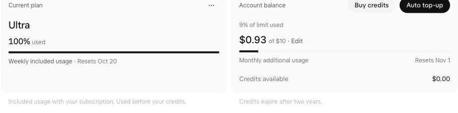

# Unified personal billing evidence

Captured on October 19, 2026, from an affected unified personal Ultra account.
All API reads and both CLI runs used the same existing Cursor session. Identity
was checked locally against `/api/auth/me`; identifiers and credentials are omitted.
This is a real response capture, not a synthetic billing example.

## Same-session responses

`GET /api/usage-summary` (relevant fields only):

```json
{
  "membershipType": "unified_ultra",
  "limitType": "user",
  "billingCycleStart": "2026-10-01T00:00:00.000Z",
  "billingCycleEnd": "2026-11-01T00:00:00.000Z",
  "isUnlimited": false,
  "individualUsage": {
    "onDemand": {
      "enabled": true,
      "used": 0,
      "limit": 1000,
      "remaining": 1000
    }
  }
}
```

`GET /api/dashboard/v2/usage-status?scope=user` (monthly portion):

```json
{
  "availability": "available",
  "monthlyUsage": {
    "usedCents": 93,
    "limitCents": 1000,
    "creditsUsedCents": 0,
    "periodStart": "2026-10-01T00:00:00.000Z",
    "resetsAt": "2026-11-01T00:00:00.000Z"
  }
}
```

The billing response also has `weeklyIncludedStatus` and `weeklyIncludedUsage`,
omitted here. Membership comes from the same-session usage summary:
`membershipType: unified_ultra`, `limitType: user`. The monthly response itself
does not contain a membership discriminator.

## Dashboard comparison

Opening the Cursor dashboard redirected to the Grok dashboard. Its billing cards
showed **$0.93 of $10**, **Monthly additional usage**, **Resets Nov 1**, and a
separate **Credits available $0.00** row. The included allowance was **100% used**,
resetting **Oct 20**.



The live `93`/`1000` values correspond to the dashboard's `$0.93`/`$10`, establishing
the cents conversion for this account. The returned monthly reset is
`2026-11-01T00:00:00.000Z`, distinct from the weekly included reset. The captured
`creditsUsedCents` is zero: this verifies the response field but does **not** prove
nonzero prepaid-credit semantics. The implementation maps `usedCents` directly;
it does not add the separate credit-consumption field. Nonzero credit isolation
is covered by a clearly synthetic regression fixture.

## Runtime and compatibility checks

Both binaries ran the production `usage --provider cursor --source web --json`
command against the live account. To prevent browser imports or Keychain prompts,
each received a private temporary copy of the existing Cursor provider configuration,
with its existing session explicitly selected as a manual cookie. Keychain access
was disabled. Temporary credentials were not retained in the evidence.

Installed **0.77.0** CLI (`06:56:55 UTC`), sanitized cost output:

```json
{
  "updatedAt": "2026-10-19T06:56:55Z",
  "used": 0,
  "limit": 10,
  "period": "Monthly",
  "resetsAt": "2026-11-01T00:00:00Z",
  "currencyCode": "USD"
}
```

Locally rebuilt PR CLI (`07:01:36 UTC`), sanitized cost output:

```json
{
  "used": 0.93,
  "resetsAt": "2026-11-01T00:00:00Z",
  "updatedAt": "2026-10-19T07:01:36Z",
  "limit": 10,
  "period": "Monthly",
  "currencyCode": "USD"
}
```

Both runs retained the included Grok Bot window at 100%, resetting
`2026-10-20T06:35:09Z`, and returned the same account identity (compared locally).
The existing configuration, stored Cursor session, and app preferences were
byte-for-byte unchanged across each CLI run.

The added stored-snapshot test decodes sanitized actual 0.77.0 output and
round-trips its identity, weekly window, and cost with the updated code. This PR
does not change the persisted configuration, session, `UsageSnapshot`, or
`ProviderCostSnapshot` schemas; `CursorStatusSnapshot` is live-only and is not
Codable. This is a data-compatibility and live CLI check, **not** a signed app
installation or GUI upgrade test. The installed app remains unchanged.

## Fallback regression

The new failure-path checks were run on the original PR code before the fix:
33 assertions failed because cost was absent on HTTP 403/500 and unavailable,
malformed, expired, or future monthly data. The updated projection falls back to
summary spend, cap, and summary reset in those cases. A valid monthly response
still overrides summary data. Zero-spend summaries retain their configured cap.

Final validation: **36 tests across five suites passed**; `make check` passed
with **zero lint violations across 3,018 files**.

Validation commands:

```sh
./Scripts/test_fast.sh --jobs 2 --filter 'CursorUnifiedUsageStatusTests|CursorSandUsageTests|CursorLegacyRequestProjectionTests|CursorTeamSpendTests|CursorSessionStoreTests'
make check
```

Local test scripts require Python with `waitid`/`WNOWAIT`; these runs use the
already installed Homebrew Python 3.14 on PATH. Full-suite validation is left to CI.
