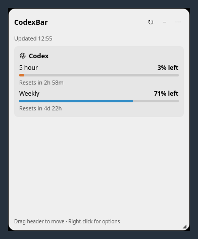

# Linux desktop

The Linux desktop is a lightweight Qt shell over the shared CodexBar CLI. See the
[Linux guide](https://github.com/steipete/CodexBar/blob/main/Integrations/Linux/README.md) for installation, settings, the local
socket interface, and isolated runtime tests.

Installation uses absolute `XDG_CONFIG_HOME` and `XDG_DATA_HOME` overrides, falling
back to `~/.config` and `~/.local/share` for unset, empty, or relative values.
The executable remains in `~/.local/bin`, regardless of `XDG_BIN_HOME`.
Launcher actions and login startup support spaces and special characters in the
home path, including quotes, dollar signs, backticks, backslashes, and percent
signs. Rerun the installer to repair existing entries affected by path escaping.

Ordinary launch and `codexbar-linux --usage` open Usage & Spend. Open the compact
window explicitly with `codexbar-linux --quick-view` or the tray's Quick View
item. **Use compact Quick View from the tray** is off by default; enabling it
changes the tray's primary activation only.

Quick View reuses the existing usage and spending models. It adds no provider
polling or cost scans on open. Optional spending is cached, labeled across
accounts, and accompanied by refresh errors and history-coverage caveats. Open
Spending to load local history or refresh its totals. Provider fetching and
authentication stay in the CLI.

## Floating gauge

The independent floating gauge is off by default. Enable **Show floating gauge**
under General in Settings, use the tray's **Floating Gauge** toggle, or open it
with `codexbar-linux --floating`. Click its capsule to expand quota/reset details;
drag the capsule or header to move, use the bottom-right grip to resize the panel,
and right-click either mode for actions without a tray. The gauge follows the
used/remaining and identity preferences and can filter the fetched providers.
Its compact entry count follows the current screen's available width, with
omitted accounts included in `+N` and accessible after expanding.

Each startup begins collapsed; visibility, expanded size, and preferences survive restarts. X11 position is
restored into an available screen; Wayland leaves placement and topmost behavior
to the compositor. Opening, expanding, and moving the gauge never starts an extra
provider query or spending scan, including when refresh-on-open is enabled.

Actual Qt 6.4.2 desktop captures using isolated fixture data on X11/Xfwm4:

See the [runtime evidence](../.github/pr-proof/linux-floating/README.md) for the
weekly-only and dual-window capsules, reset countdowns, context menu, restart
behavior, query logs, and a reproducible capture script. Other window managers
and Wayland need separate validation.
